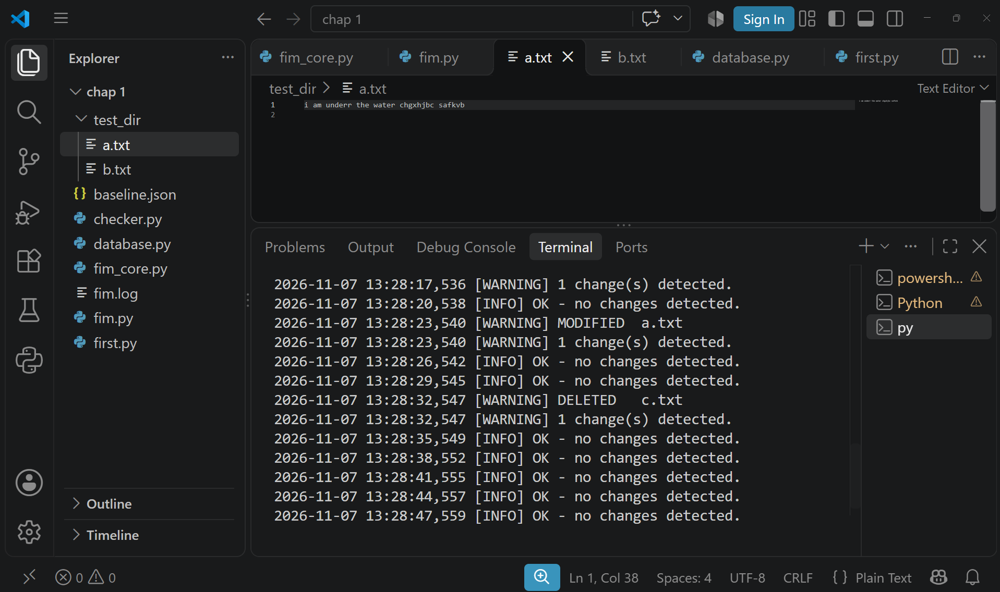

# File Integrity Monitor

A Python tool that detects unauthorized file changes by comparing SHA-256
hashes against a trusted baseline. Uses only the Python standard library.

## Features
- SHA-256 hashing (reads files in chunks, so large files are fine)
- Detects added, deleted and modified files, plus permission changes
- Exclude patterns (e.g. `.git`, `*.log`)
- HMAC-signed baseline to detect tampering (set `FIM_KEY`)
- Three modes: `init`, `check`, `watch`
- Logging to console and `fim.log`, JSON reports

## Usage
Create a baseline of a folder:

    py fim.py init test_dir

Check for changes:

    py fim.py check --report report.json

Monitor continuously (every 5 seconds):

    py fim.py watch --interval 5

Protect the baseline against tampering (PowerShell):

    $env:FIM_KEY="a-long-random-secret"

## Exit codes
0 = clean, 1 = changes found, 2 = baseline tampered or corrupt.

## Demo

## Limitations
Polling-based rather than kernel events. No email alerts yet.
